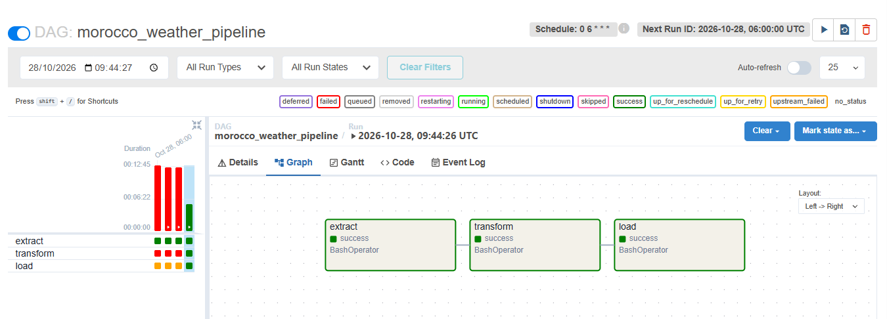
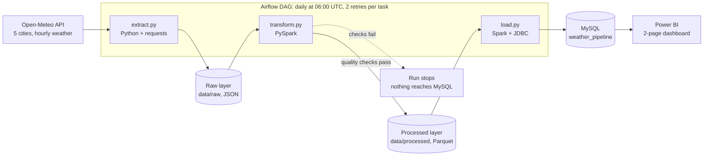

# Morocco Weather Data Pipeline

An automated, end-to-end data pipeline. Every day it collects hourly weather data for five Moroccan cities, cleans and checks it with Apache Spark, stores it in MySQL, and feeds a Power BI dashboard. Airflow runs the whole chain on a schedule, and everything runs in Docker.

**Stack:** Python · Apache Spark (PySpark) · Apache Airflow · MySQL · Docker · Power BI



## Contents

- [Scenario](#scenario)
- [Architecture](#architecture)
- [Tech stack](#tech-stack)
- [Project structure](#project-structure)
- [How each part works](#how-each-part-works)
- [Data quality checks](#data-quality-checks)
- [Dashboard](#dashboard)
- [Design decisions](#design-decisions)
- [A problem I ran into](#a-problem-i-ran-into)
- [How to run it](#how-to-run-it)
- [Limitations and next steps](#limitations-and-next-steps)
- [Data source](#data-source)
- [Author](#author)

## Scenario

A company working in agriculture or tourism wants to know which Moroccan cities are getting hotter, when it rains the most, and how this year compares with previous ones. They need the answers refreshed every day, without anyone running scripts by hand, and they need to trust the numbers.

This project builds the pipeline that delivers clean, up-to-date data to a dashboard automatically.

**Scope:** 5 cities (Casablanca, Rabat, Marrakech, Fes, Tangier), hourly temperature and precipitation from January 2021 onwards. That is about 255,000 hourly rows and about 10,600 daily rows.

## Architecture



The data moves through three layers. Each layer is a safe point to restart from:

| Layer | Where | Content |
|---|---|---|
| Raw | `data/raw/` | Exactly what the API returned. Never modified. |
| Processed | `data/processed/` | Clean, deduplicated, checked Parquet files. |
| Serving | MySQL | Tables ready for analysis and dashboards. |

## Tech stack

| Tool | Role in the project |
|---|---|
| Python, `requests` | Extract data from the REST API |
| Apache Spark (PySpark 4.0, local mode) | Flatten, deduplicate, check and aggregate the data |
| Parquet | Columnar storage format for the processed layer |
| MySQL 8 | Serving database, accessed through Spark JDBC |
| Apache Airflow 2.11 | Schedule the tasks, enforce their order, retry failures |
| Docker, Docker Compose | Package Airflow, Java and Spark so the project runs the same everywhere |
| Power BI | Dashboard for the business questions and for pipeline health |
| Git, GitHub | Version control |

## Project structure

```text
morocco-weather-pipeline/
├── dags/                  Airflow DAG (weather_dag.py)
├── src/
│   ├── extract.py         API → raw JSON (backfill and daily modes)
│   ├── transform.py       Spark: flatten, deduplicate, check, aggregate
│   └── load.py            Spark JDBC → MySQL
├── sql/create_tables.sql  Database, dedicated user, tables and primary keys
├── dashboard/             Power BI file (morocco_weather.pbix)
├── docs/                  Screenshots used in this README
├── notebooks/             Exploration of the raw data before writing the scripts
├── Dockerfile             Airflow image with Java and PySpark added
├── docker-compose.yml     One Airflow service, project folder mounted
├── .env.example           Connection settings without the password
└── README.md
```

## How each part works

### 1. Extract (`src/extract.py`)

The script has two modes, chosen with a command-line argument:

- **`backfill`** loads the history once, from the archive API (2021-01-01 up to 7 days ago).
- **`daily`** loads the last 7 days from the forecast API. Airflow runs this one every morning.

Each response is saved untouched as `data/raw/date=YYYY-MM-DD/<city>_<mode>.json`. The folder date is the extraction date, in the partition style used by data lakes.

The daily mode fetches 7 days instead of only yesterday on purpose. If a run fails on Tuesday, Wednesday's run still covers Tuesday, so the pipeline repairs itself. The overlap creates duplicate hours, which the next step removes.

### 2. Transform (`src/transform.py`)

Written as one function per step, so a failure points at the guilty function:

1. **Read** every raw JSON file and take the city and mode from the file name. The API does not return the city name, and the raw files must stay unmodified.
2. **Flatten.** Each file holds lists (time, temperature, precipitation). Spark zips them and explodes them into one row per city per hour.
3. **Deduplicate.** When the same city and hour appear twice, the most recent extraction wins. On the same day, the archive (final, checked values) beats the forecast.
4. **Check quality** (see below). If a check fails, the script stops before writing anything.
5. **Aggregate** into a daily table: min, max and average temperature, total precipitation, a 7-day rolling average (window function) and a rainy-day flag (1 mm or more).
6. **Write** two Parquet tables, `weather_hourly` (partitioned by city) and `weather_daily`.

### 3. Load (`src/load.py`)

Spark reads the Parquet tables and writes them into MySQL through JDBC. The tables are created beforehand in SQL, with explicit types and primary keys, and loaded with `truncate` + `overwrite`: Spark empties the table and refills it, so the schema survives.

### 4. Orchestrate (`dags/weather_dag.py`)

```text
extract >> transform >> load
```

- Runs every day at 06:00 UTC (`0 6 * * *`), with `catchup=False`.
- Each task retries twice, five minutes apart.
- A task only starts when the previous one succeeded. If `transform` fails, `load` is marked `upstream_failed` and never runs.

### 5. Visualize (Power BI)

Two pages. See [Dashboard](#dashboard).

## Data quality checks

Run inside `transform.py`, before anything is written. Any failure raises an error and stops the pipeline.

| Dimension | Check |
|---|---|
| Completeness | No null value in any column |
| Uniqueness | Exactly one row per city and hour |
| Validity | Temperature between -20 °C and 55 °C, precipitation never negative |

## Dashboard

**Page 1: Weather overview** answers the three business questions: which cities are getting hotter (7-day average temperature), when it rains most (rainy days per month), and how each year compares (city by year matrix).


**Page 2: Pipeline health** monitors the pipeline itself: is the data fresh (latest day loaded), is it complete (days where `hours_recorded` is not 24, which should be none), and is it balanced (same number of days in every city).


## Design decisions

- **The raw layer is never modified.** Anything downstream can be rebuilt from it, so a bug in the transformation never destroys data.
- **Reruns are safe (idempotence).** Parquet is overwritten, MySQL is truncated and reloaded, and primary keys reject duplicates. Running the pipeline twice gives the same result as once.
- **Quality checks come before the writes.** Bad data stops at the gate and never reaches MySQL or the dashboard.
- **An orchestrator instead of a scheduled script.** Airflow gives task dependencies, retries and logs per task, which the Windows Task Scheduler did not.
- **Least privilege.** The pipeline uses a dedicated MySQL user limited to its own database. Passwords live in `.env`, which is excluded from Git and from the Docker build.
- **One Airflow container (standalone mode), with Spark in local mode.** This fits on an 8 GB laptop. The official multi-container setup does not.
- **Honest note on Spark.** About 255,000 rows would fit in pandas. I chose Spark so the same code keeps working if the project grows to more cities and more years.

## A problem I ran into

The first Airflow run failed at the Spark write with `Unable to clear output directory`. Files in `data/processed/` had been created earlier by a Jupyter container, which runs as a different Linux user than the Airflow container, so Airflow was not allowed to delete them.

The quality checks had already passed, and Airflow blocked `load`, so nothing broken reached MySQL. The fix was to delete the folder (it is rebuilt from the raw layer anyway) and let Airflow be its only owner.

## How to run it

**Prerequisites:** Docker Desktop, MySQL 8 running on your machine, and Power BI Desktop (only to open the dashboard). Tested on Windows with Docker Desktop (WSL 2).

1. **Clone the repo**
   ```bash
   git clone https://github.com/asma-pp1/morocco-weather-pipeline.git
   cd morocco-weather-pipeline
   ```
2. **Create the database.** Edit the password in `sql/create_tables.sql`, then run the file in MySQL.
3. **Create your settings file.** Copy `.env.example` to `.env` and fill in the password.
4. **Start Airflow**
   ```bash
   docker compose up -d --build
   ```
5. **Load the history once**
   ```bash
   docker compose exec airflow bash -c "cd /opt/project && python src/extract.py backfill"
   ```
6. **Open Airflow** at http://localhost:8080. The user is `admin`, and the password is printed by:
   ```bash
   docker compose exec airflow cat /opt/airflow/standalone_admin_password.txt
   ```
7. **Run the pipeline.** Un-pause the `morocco_weather_pipeline` DAG and click **Trigger DAG**. All three tasks should turn green.
8. **Check the result** in MySQL:
   ```sql
   SELECT COUNT(*) FROM weather_daily;
   SELECT MAX(day) FROM weather_daily;
   ```
9. **Open the dashboard.** Open `dashboard/morocco_weather.pbix` and click **Refresh**.

To pause Airflow without losing its history, use `docker compose stop`.

## Limitations and next steps

- Every run reloads the MySQL tables completely. Fine at this size, but an incremental upsert would scale better.
- The quality checks do not yet verify coverage (24 hours per day, same number of days per city). Today that is only visible on the dashboard's health page.
- Spark runs in local mode inside one container. A real cluster would need a different deployment.
- No alerting yet. A failed run is visible in Airflow, but nobody is notified.
- Possible improvements: failure alerts by email or Slack, automated tests for the transformation functions, and running the stack in the cloud.

## Data source

Weather data by [Open-Meteo.com](https://open-meteo.com/), licensed under [CC BY 4.0](https://creativecommons.org/licenses/by/4.0/). Free for non-commercial use, no API key required.

Historical data (backfill): https://archive-api.open-meteo.com/v1/archive
Recent data (daily runs): https://api.open-meteo.com/v1/forecast

## Author

Ezzarouali Asma · [LinkedIn](https://www.linkedin.com/in/asma-e-518b091b9/) · [GitHub](https://github.com/asma-pp1)